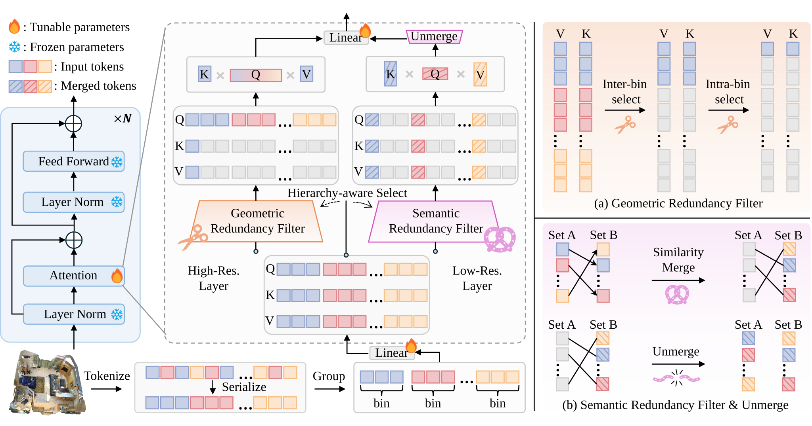
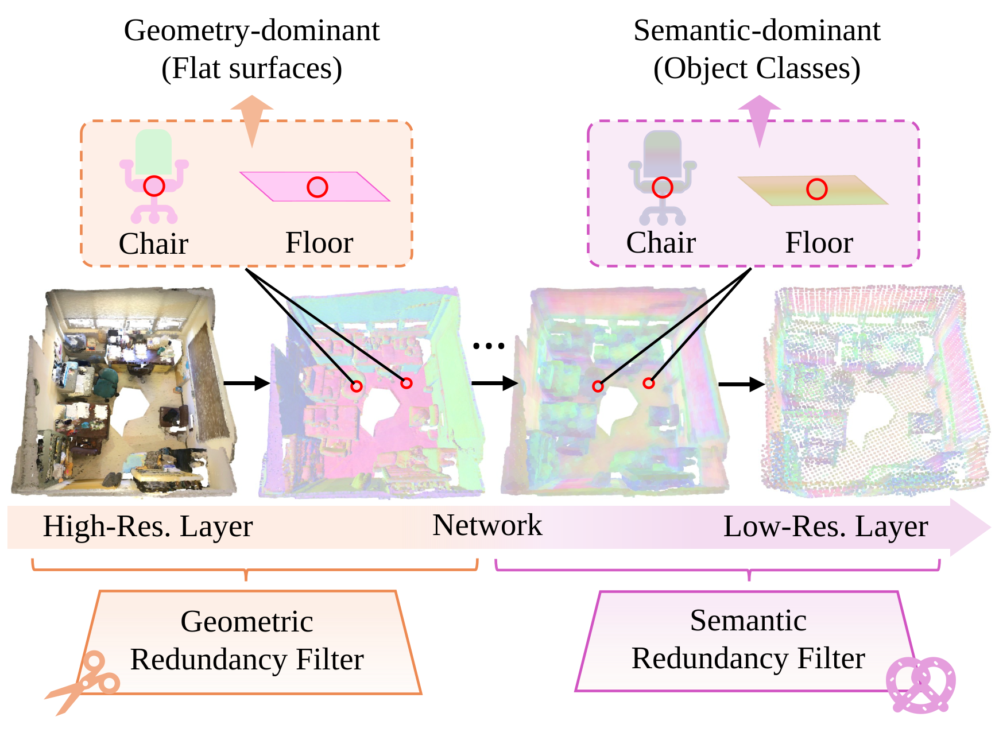
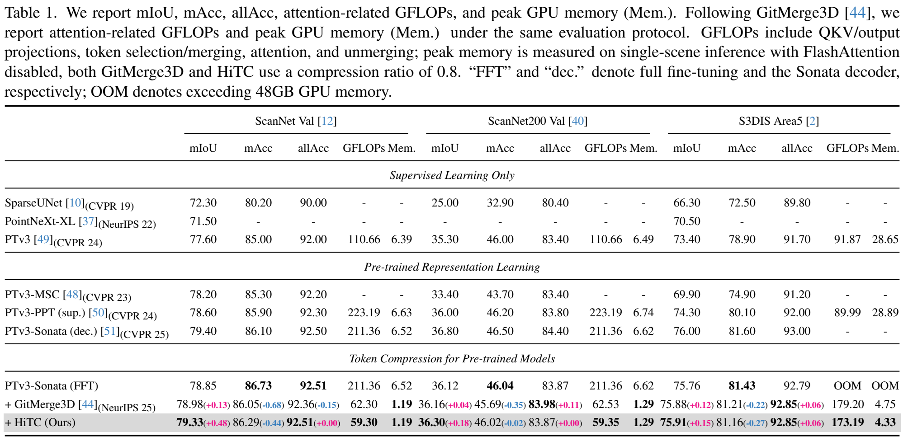

<div align="center">

<h1>HiTC: Hierarchy-aware Token Compression<br>for Efficient Point Cloud Scene Understanding</h1>

<p>Yang Li, Yan Zhang, Siyuan Liu, Lianbo Guo, <a href="https://dk-liang.github.io/">Dingkang Liang</a><sup>*</sup></p>

<p>Huazhong University of Science and Technology, Wuhan, China</p>

<p><sup>*</sup> Corresponding author</p>

</div>

---

## News

- **[28/Oct/2026]** 🚀 The HiTC project repository is initialized. Code and model checkpoints are coming soon.

---

## TODO

- [x] Initialize the public HiTC repository.
- [ ] Release environment configuration and installation instructions.
- [ ] Release training and inference code.
- [ ] Release pretrained model weights.
- [ ] Complete upstream code attribution, licensing information, and the paper link and BibTeX when available.


## Abstract

Scene-level point cloud understanding is computationally expensive due to dense token interactions in Transformer-based models. The existing token compression method applies a fixed compression strategy across network layers, overlooking the hierarchical evolution of token redundancy and limiting the accuracy-efficiency trade-off. To address this issue, we propose **Hierarchy-aware Token Compression (HiTC)** for efficient point cloud scene understanding. The core idea is based on the observation that token redundancy evolves across representation hierarchies: high-resolution representations retain more local geometric redundancy, whereas low-resolution representations exhibit stronger semantic redundancy. Based on this observation, HiTC first leverages a serialization-based local bin construction module to organize tokens into spatially coherent bins. It then proposes hierarchy-aware redundancy filtering to remove geometric redundancy from high-resolution network layers and semantic redundancy from low-resolution network layers. Extensive experiments on ScanNet, ScanNet200, and S3DIS demonstrate that HiTC effectively reduces computational costs while maintaining competitive segmentation performance.

---

<div align="center">

[📌 Overview](#1-overview) &nbsp;|&nbsp; [📊 Results](#2-results) &nbsp;|&nbsp; [⚙️ Get Started](#3-get-started) &nbsp;|&nbsp; [🙏 Acknowledgement](#4-acknowledgement) &nbsp;|&nbsp; [📖 Citation](#5-citation)

</div>

---

## 1. Overview

<p align="center">
  
</p>

**HiTC compresses tokens according to the redundancy patterns at different representation hierarchies.** It combines:

- **Serialization-based Local Bin Construction (SLBC):** organizes point tokens into spatially coherent local bins.
- **Geometric Redundancy Filtering (GRF):** reduces geometric redundancy in high-resolution layers through inter-bin and intra-bin key-value token selection.
- **Semantic Redundancy Filtering (SRF):** reduces semantic redundancy in low-resolution layers through similarity-based token merging and unmerging.

<details>
<summary><b>💡 Why use different filtering strategies across layers?</b></summary>

<p align="center">
  
</p>

High-resolution representations contain repeated local geometric patterns, while low-resolution representations exhibit stronger semantic redundancy. HiTC adapts the compression mechanism to these different redundancy patterns.

</details>

---

## 2. Results

### 2.1 Main Results

<p align="center">
  <a href="assets/main_results.png"></a>
</p>

*HiTC achieves higher mIoU than the uncompressed PTv3-Sonata full-fine-tuning baseline and GitMerge3D on ScanNet, ScanNet200, and S3DIS, while requiring fewer attention-related GFLOPs than GitMerge3D on all three benchmarks.*

### 2.2 Visualization

<p align="center">
  
</p>

*Qualitative comparisons on (a) ScanNet, (b) ScanNet200, and (c) S3DIS. HiTC maintains competitive segmentation quality after token compression, including fine-grained regions and adjacent objects with similar appearances.*

---

## 3. Get Started

> 🚧 **Code release in preparation.** Installation instructions, training and evaluation configurations, and model checkpoints will be added with the implementation release.

### 3.1 Installation

You can clone the project repository with:

```bash
git clone https://github.com/euitbly/HiTC.git
cd HiTC
```

The HiTC environment setup will be documented with the code release. For background on the backbone and pretrained representations, please refer to [PTv3](https://github.com/Pointcept/PointTransformerV3) and [Sonata](https://github.com/facebookresearch/sonata).

### 3.2 Data Preparation

We evaluate HiTC on **ScanNet**, **ScanNet200**, and **S3DIS**. General preprocessing instructions are available in the [Pointcept documentation](https://github.com/Pointcept/Pointcept#data-preparation). HiTC-specific directory conventions will be documented with the implementation.

### 3.3 Training and Evaluation

HiTC follows a two-stage fine-tuning pipeline:

1. **Baseline fine-tuning:** fine-tune the uncompressed PTv3 model initialized with Sonata pretrained weights on the target dataset.
2. **Compression-aware fine-tuning:** enable HiTC and fine-tune attention-related parameters, including the query, key, value, and attention output projections.

Reproducible commands for both stages, inference, and efficiency evaluation will be provided with the code release.

### 3.4 Model Zoo

| Dataset | Split | mIoU (%) | Checkpoint |
|:---|:---|---:|:---:|
| ScanNet | Validation | 79.33 | Coming soon |
| ScanNet200 | Validation | 36.30 | Coming soon |
| S3DIS | Area 5 | 75.91 | Coming soon |

---

## 4. Acknowledgement

HiTC uses the **PTv3** architecture initialized with **Sonata** pretrained weights. We thank the authors of the following projects for their contributions to point cloud representation learning and efficient scene understanding:

- **Sonata:** [Paper](https://arxiv.org/abs/2503.16429) · [Code](https://github.com/facebookresearch/sonata)
- **Point Transformer V3 (PTv3):** [Paper](https://arxiv.org/abs/2312.10035) · [Code](https://github.com/Pointcept/PointTransformerV3)
- **Pointcept:** [Codebase and documentation](https://github.com/Pointcept/Pointcept)
- **GitMerge3D:** [Paper](https://arxiv.org/abs/2511.05449) · [Code](https://github.com/anhtuanhsgs/GitMerge3D) · [Project page](https://gitmerge3d.github.io/)

The presentation of this README is inspired by [PointTPA](https://github.com/H-EmbodVis/PointTPA). We thank the authors for sharing their work.

---

## 5. Citation

If you find HiTC useful in your research, please consider giving this repository a star ⭐ and citing our work. Citation details will be provided when the preprint is publicly available.

